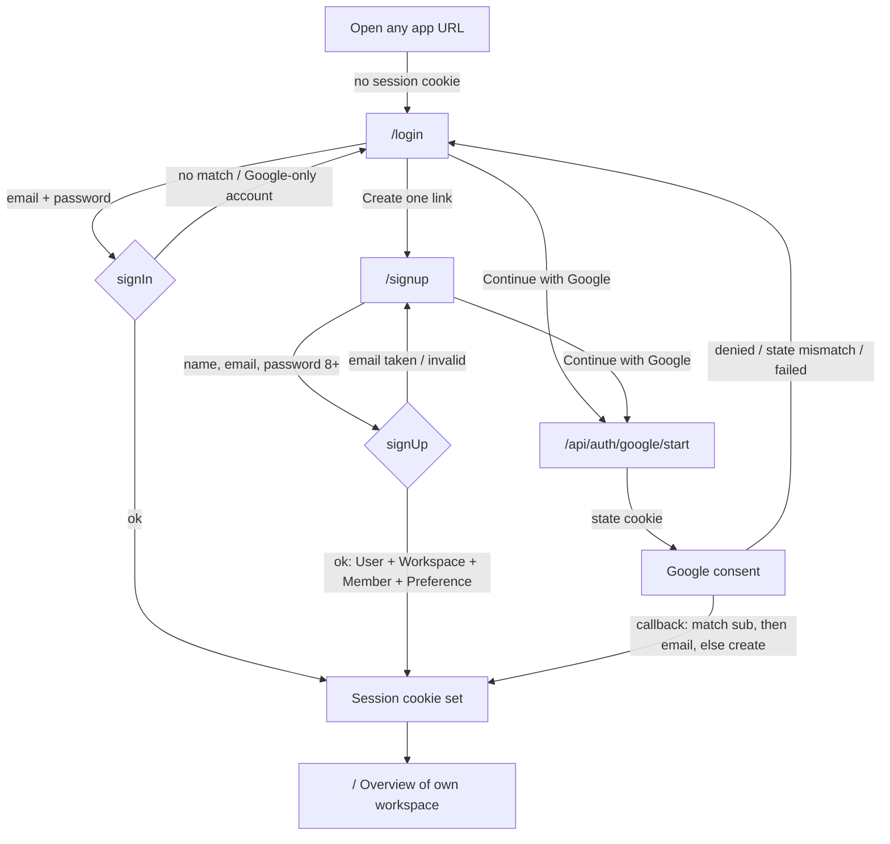
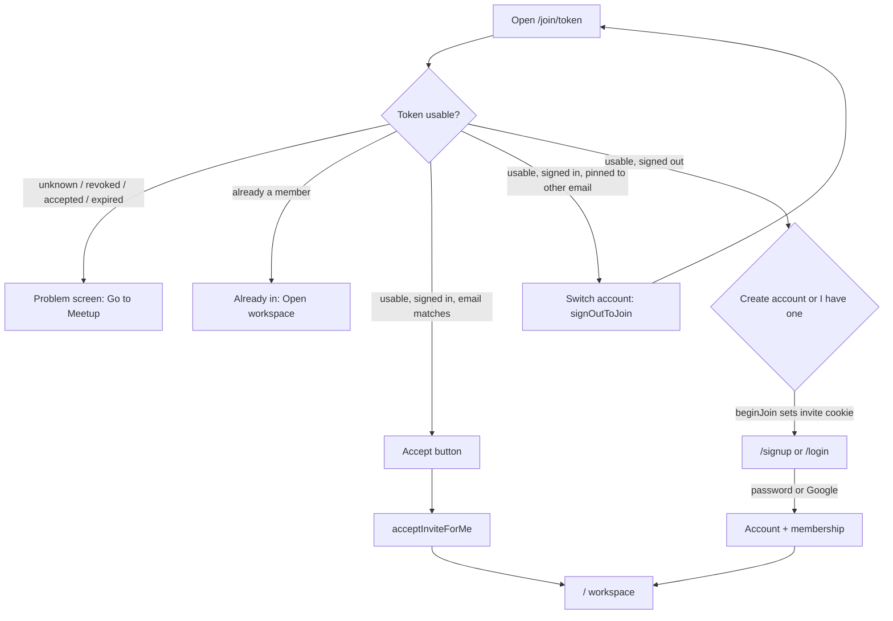
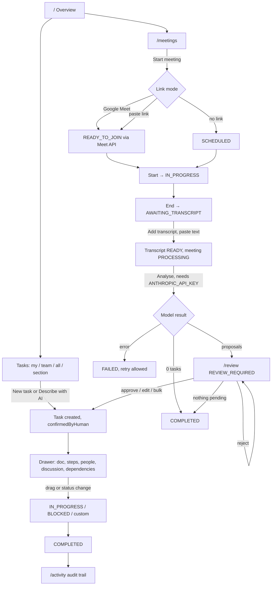
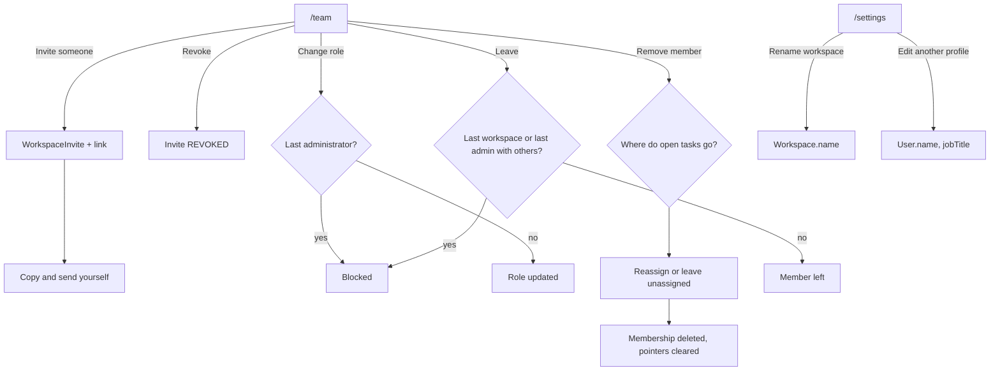

# Meetup — user flow

Derived from the code on 2026-11-04 (`src/app`, `src/backend/actions`, `src/backend/auth`,
`src/backend/team`, `prisma/schema.prisma`). Despite the name, Meetup is **not an
events / RSVP product**: it is a shared workspace where a team turns meeting
conversations into owned, trackable tasks. The "main goal" of every journey is
therefore *a meeting becomes approved tasks that get done*.

## Who the code knows about

| User type | How the code defines it | Where it lives |
|---|---|---|
| **Visitor** | No `meetup_session` cookie (or an expired `Session` row) | `/login`, `/signup`, `/join/[token]`, Google sign-in routes |
| **Invited colleague** | A visitor or member holding a `WorkspaceInvite` link | `/join/[token]` → auth → workspace |
| **Workspace member** | `WorkspaceMember` row; role `ADMINISTRATOR` (default) or `MEMBER` | Everything under `src/app/(app)/` |
| **Administrator** | `WorkspaceMember.role = ADMINISTRATOR` — the only role gate in the code (`requireAdministrator`) | `/team`, parts of `/settings` |

There is no super-admin / platform-admin role. Every read and write is scoped by
the `workspaceId` that `requireSession()` resolves from the cookie, never from
the browser.

### Route map

| Route | Purpose | Guard |
|---|---|---|
| `/login`, `/signup` | Email + password, or "Continue with Google" | Redirects to `/` if already signed in |
| `/api/auth/google/start` → `/api/auth/google/callback` | Google identity sign-in (no tokens stored) | — |
| `/join/[token]` | Invite landing page | Readable without a session |
| `/` | Overview dashboard | `requireSession` |
| `/my-tasks`, `/team-tasks[?owner=id]`, `/all-tasks`, `/spaces/[id]` | Task list / board | `requireSession` |
| `/meetings`, `/meetings/[id]` | Meeting list and lifecycle | `requireSession` |
| `/review` | AI proposals waiting for a human | `requireSession` |
| `/team` | Members, invites, roles, leave | `requireSession` (admin-only panels) |
| `/knowledge[/id]`, `/flowcharts[/id]`, `/activity`, `/settings` | Library, diagrams, audit trail, settings | `requireSession` |
| `/api/google/connect` → `/api/google/callback` | Google **Meet** OAuth (tokens stored in `GoogleAccount`) | Session required |
| `/api/attachments` (POST), `/api/attachments/[id]` (GET) | Images/files inside documents | Session + workspace check |

---

## 1. Visitor → first session

| # | Step | Page / route | Data created or changed | Decisions, errors, empty states |
|---|---|---|---|---|
| 1 | Land anywhere | any `(app)` route | — | `requireSession()` finds no usable session → `redirect("/login")`. Expired `Session` rows are deleted on the spot. |
| 2 | Choose a way in | `/login` | — | Google button only renders when `GOOGLE_CLIENT_ID` + `GOOGLE_CLIENT_SECRET` are set; otherwise the page says so. `?google=` notices: `denied`, `state-mismatch`, `not-configured`, `failed`, `unknown`. If an invite cookie is present the heading changes to "Join {workspace}". |
| 3a | Sign in with password | `signIn` action | `Session` (SHA-256 of a random token, 30-day expiry) | Same error for unknown email and wrong password (no enumeration). A Google-only account (`passwordHash = null`) gets "use Google" instead. A remembered invite is accepted silently. |
| 3b | Create an account | `/signup` → `signUp` | `User`, `Workspace` ("{First}'s workspace", unique slug), `WorkspaceMember` (ADMINISTRATOR), `UserPreference` (last + primary workspace), `ActivityEvent MEMBER_JOINED`, then `Session` | Name 2–80, valid email, password 8–200. Duplicate email rejected (also on the unique index race). No email verification step. If an invite cookie is present, the account joins that workspace **instead of** getting its own (see §2). |
| 3c | Continue with Google | `/api/auth/google/start` → Google → `/api/auth/google/callback` | `User.googleSub` linked (by `sub`, then by verified email), or a new account provisioned as in 3b; `Session` | Already signed in → straight to `/`. Missing/mismatched `state` cookie → `/login?google=state-mismatch`. Consent refused → `denied`. Any exchange error → `failed`. No Google tokens are stored for sign-in. |
| 4 | Land in a workspace | `/` | — | `getSessionContext` picks `lastWorkspaceId` → `primaryWorkspaceId` → oldest membership. A user with **no membership at all** is treated as signed out (redirect to `/login`). |

---

## 2. Invited colleague → joins an existing workspace

| # | Step | Page / route | Data created or changed | Decisions, errors, empty states |
|---|---|---|---|---|
| 1 | Admin creates a link | `/team` → `createInvite` | `WorkspaceInvite` (token, optional pinned email, role, job title, 7-day expiry), `ActivityEvent MEMBER_INVITED` | Admin only. Pinned email already a member → "already a member". A second pending invite for the same email revokes the first. No email is sent — the admin copies the link. |
| 2 | Colleague opens the link | `/join/[token]` | — | Four states handled: usable; already a member (membership checked **before** invite state, so a spent own link reads as "you're in"); signed in as the wrong address; or a problem (`unknown`, `revoked`, `accepted`, `expired`, `wrongEmail`). |
| 3a | Signed in and allowed | `acceptInviteForMe` | `WorkspaceInvite` → ACCEPTED (only `WHERE status = PENDING`, so a race yields one winner), `WorkspaceMember` with the invite's role/title, `UserPreference.lastWorkspaceId`, `ActivityEvent MEMBER_JOINED` | Errors surface inline as `errors.invite.*`. |
| 3b | Signed in as someone else | `signOutToJoin` | `Session` deleted | Returns to the same `/join` URL signed out. |
| 3c | Signed out | `beginJoin` (form POST) → `/signup` or `/login` | `meetup_invite` httpOnly cookie (60 min) | Works without JavaScript. Both auth pages then show "Join {workspace}". |
| 4 | Finish auth | `signUp` / `signIn` / Google callback | New sign-up from an invite creates **no personal workspace**: `User` + membership in the inviting workspace + preference pointing there. Existing accounts accept the invite as an extra membership. | An unusable or email-mismatched invite is ignored silently and the person gets (or keeps) their own workspace instead of an error page. |
| 5 | Arrive | `/` | — | Lands in the invited workspace. Everyone joins as ADMINISTRATOR unless the invite said MEMBER. |

---

## 3. Workspace member → daily work (the core loop)

### 3.1 Orientation

| # | Step | Page / route | Data | Decisions, errors, empty states |
|---|---|---|---|---|
| 1 | Overview | `/` | reads `Task`, `Meeting`, `ActivityEvent`, `TaskProposal` counts | Greeting, KPI row, own panel + counterpart panel (a two-person workspace names the other person; otherwise "waiting for assignee"), next meeting ("Nothing scheduled"), recent activity ("Nothing has happened yet"), recommendations ("Nothing to flag"), a "{n} proposals waiting" banner. |
| 2 | Header alerts | all pages | derived | Bell shows `overdue`, `today`, `review`, `unclear` (tasks with `needsReview`), `transcripts` (meetings awaiting). Empty: "Nothing needs you". |
| 3 | Search | ⌘K palette → `searchWorkspace` | — | Min characters notice; "Nothing matches" state; hits are tasks, meetings, knowledge pages. |
| 4 | Switch workspace | sidebar name → `switchWorkspace` / `createWorkspace` / `setMainWorkspace` | `UserPreference.lastWorkspaceId` (+ `primaryWorkspaceId`), or new `Workspace` + ADMINISTRATOR membership | Membership is the check; a foreign id fails with "not a member". Name 2–80 chars. |

### 3.2 Tasks

| # | Step | Page / route | Data | Decisions, errors, empty states |
|---|---|---|---|---|
| 1 | Browse | `/my-tasks`, `/team-tasks`, `/all-tasks`, `/spaces/[id]`, `/spaces/none` | reads `Task` with owner, assignees, space, subtasks | List or board (choice stored in `localStorage`). Counts: open · total · overdue · matching. Empty: "No tasks match these filters" / "Nothing here yet". `?owner=` naming nobody is ignored. A deleted section's URL shows "section gone → back to all tasks" instead of a 404. |
| 2 | Create by hand | New task dialog → `createTask` | `Task` (`confirmedByHuman = true`), `TaskAssignee[]`, `Subtask[]`, `ActivityEvent TASK_CREATED` | Title 3–200, doc ≤ 50 000 chars, ≤ 20 assignees (owner dropped from co-assignees), ≤ 10 labels, status must exist in the workspace (`errors.status.gone`), owner/space must be in the workspace. Task started from a section board is pre-filed there. |
| 3 | Create by describing | "Describe" mode → `draftTasksFromBrief` → `createTasksFromDrafts` | nothing on draft; then `Task[]` (`isAiGenerated`, `confirmedByHuman`), `ActivityEvent` per task | Disabled without `ANTHROPIC_API_KEY` ("needs key"). Brief too short / too long / yields no tasks → inline error. Drafts with unresolved owner are flagged "needs you"; the person picks which drafts to create. |
| 4 | Work the task | detail drawer → `updateTask`, `moveTask`, subtask actions, `addDependency` | `Task` fields, `Subtask`, `TaskDependency`, one `ActivityEvent` per changed field (status / owner / priority / due / section) | Optimistic UI with rollback toast on failure. Any human edit sets `confirmedByHuman = true`, clears `needsReview`. Self-dependency and cycles rejected. Moving between owner columns reassigns, never copies. |
| 5 | Attach files / images | paste or drop → `POST /api/attachments` | `Attachment` (bytes in Postgres, workspace-scoped) | 401 no session, 400 no file / two owners, 404 doc not in workspace, 415 wrong type, 413 over limit. Served only with a session in the owning workspace. |
| 6 | Discuss | drawer → `addComment`, `answerWithAi` | `TaskComment` (MESSAGE), optional `TaskComment` (AI_ANSWER, `answersId` unique → idempotent) | Empty note / > 4000 chars rejected. `@ai` only answers when a key is set; the human message always lands first; a failed answer shows a retry. |
| 7 | Organise | sidebar `+` → `createSpace`; status dialog → `createStatus` | `Space`, `TaskStatusDefinition` (max 12 custom, 4 built-ins undeletable) | Duplicate section name rejected. Deleting a section moves its tasks to "No section" and says how many were freed. |
| 8 | Finish | status → COMPLETED | `Task.completedAt`, `ActivityEvent TASK_COMPLETED` (or `TASK_REOPENED`) | Only `COMPLETED` is special-cased: hidden from open lists, counted in stats. |
| 9 | Delete | drawer → `deleteTask` | `Task` cascade (assignees, subtasks, comments, attachments, dependencies), `ActivityEvent TASK_DELETED` | No confirmation gate in the action itself. |

### 3.3 Meetings → transcript → AI review → approved tasks

| # | Step | Page / route | Data | Decisions, errors, empty states |
|---|---|---|---|---|
| 1 | List | `/meetings` | reads `Meeting` + transcript/analysis summaries | Grouped into *Needs attention* (AWAITING_TRANSCRIPT, PROCESSING, REVIEW_REQUIRED, FAILED), *Upcoming* (SCHEDULED, READY_TO_JOIN, IN_PROGRESS), *Completed*. Empty: "No meetings yet". Seeded rows carry a "sample data" badge. |
| 2 | Start a meeting | dialog → `createMeeting` | `Meeting` (+ `MeetingParticipant[]` for picked members, `speakerLabel` = name), `ActivityEvent MEETING_CREATED` | Three modes: **Google Meet** (disabled unless env configured *and* account connected; real `spaces.create` call or an explicit error — never a fake URL), **paste link** (must be `https://…meet.google.com`), **no link yet** (status SCHEDULED). Title 3–160. `scheduledAt` defaults to now. |
| 3 | Run it | `/meetings/[id]` stepper | `Meeting.status`, `startedAt` / `endedAt`, `ActivityEvent MEETING_UPDATED` | Buttons: *Start* (SCHEDULED/READY_TO_JOIN → IN_PROGRESS), *End* (→ AWAITING_TRANSCRIPT), *Join call* (external Meet link). The list menu also offers mark in progress / ended. FAILED shows a badge. |
| 4 | Add transcript | "Add transcript" dialog → `saveManualTranscript` | `Transcript` (status READY, source MANUAL), `Meeting.status = PROCESSING`, `ActivityEvent TRANSCRIPT_READY` | 40–400 000 chars. Replaces an existing transcript. Expected format `Name: what they said`, one turn per line. Text is loaded on demand (`getTranscriptText`) — never shipped in list payloads. |
| 5 | Analyse | *Analyse* button → `analyseMeeting` | `MeetingAnalysis` (RUNNING → COMPLETED/FAILED, summary, decisions, open questions, token counts), pending `TaskProposal[]` replaced, `Meeting.status` → REVIEW_REQUIRED (tasks proposed) or COMPLETED (none), `ActivityEvent ANALYSIS_COMPLETED` | Button disabled with a tooltip when no key. Requires a READY transcript with content. Proposals already APPROVED/REJECTED survive re-analysis. Unresolved owner forces `needsReview`. Model error → analysis FAILED + meeting FAILED, re-run allowed. |
| 6 | Review | `/review` (also inline on the meeting page) → `approveProposal`, `rejectProposal`, `approveProposals` | `Task` (`isAiGenerated`, `confirmedByHuman = true`, `sourceMeetingId`, `sourceExcerpt`, AI's priority kept beside the human's), `TaskProposal` → APPROVED/REJECTED with reviewer, `TaskDependency` resolved by title, `ActivityEvent PROPOSAL_*`, then `settleMeetingStatus` | Every value shows an evidence badge (Confirmed / Inferred / Suggested). Owner editor opens by default when ownership was not confirmed. Approving twice returns the existing task. Owner must be in the workspace. Bulk approve caps at 50 and reports approved/failed. Empty: "Nothing waiting for review → Go to meetings". A warning strip appears when AI is not configured. |
| 7 | After the meeting | `/meetings/[id]` bottom, task drawer "Source" | — | The meeting page lists tasks whose `sourceMeetingId` matches (empty: "add a transcript" / "you can analyse"). Each task links back to its meeting and quote. Meeting reaches COMPLETED once no proposal is PENDING. `deleteMeeting` cascades transcript, analysis, proposals; tasks keep living (`sourceMeetingId` → null). |

### 3.4 Knowledge, flowcharts, activity, settings

| Area | Route | Data | Notes |
|---|---|---|---|
| Knowledge | `/knowledge`, `/knowledge/[id]` | `KnowledgeDoc`, `Attachment`, `ActivityEvent KNOWLEDGE_*` | Label filter, body search, pin. Autosave. Empty: "The library is empty → Write the first page"; "Nothing matches". Missing id → 404. |
| Flowcharts | `/flowcharts`, `/flowcharts/[id]` | `Flowchart.document` JSON (nodes/edges) | New chart seeded with start/step/end. Autosave. Empty + no-match states. |
| Activity | `/activity` | reads `ActivityEvent` (last 120) + task stats | Completion rate, status distribution, per-member load, "needs a decision" count. Empty: "Nothing has happened yet". |
| Settings | `/settings` | `User.name/accentToken`, `WorkspaceMember.jobTitle`, `UserPreference.defaultSort`, `GoogleAccount` | Profile (self only unless admin), default ordering, Google Meet connect/disconnect with `?google=` notices (connected, denied, state-mismatch, exchange-failed, not-configured), and a checklist of missing env vars for Google and Anthropic. Workspace rename is admin-only. |
| Sign out | sidebar menu → `signOut` | `Session` deleted | Redirects to `/login`. |

---

## 4. Administrator → runs the workspace

| # | Step | Page / route | Data | Decisions and guards |
|---|---|---|---|---|
| 1 | Invite | `/team` → `createInvite` | `WorkspaceInvite`, `ActivityEvent MEMBER_INVITED` | Role defaults to ADMINISTRATOR; MEMBER offered. Optional pinned email and job title. Link shown once with "works for anyone / {days} days" note; pending list with copy + revoke. |
| 2 | Revoke | `revokeInvite` | `WorkspaceInvite.status = REVOKED` | Only PENDING rows; otherwise "invite gone". |
| 3 | Change role | `changeMemberRole` | `WorkspaceMember.role`, `ActivityEvent MEMBER_ROLE_CHANGED` | Cannot demote the last administrator. |
| 4 | Remove | `removeMember` | open `Task.ownerMemberId` reassigned or nulled, `ActivityEvent MEMBER_REMOVED` (written *before* the delete), `WorkspaceMember` deleted, `UserPreference` pointers cleared | Cannot remove yourself or the last administrator. Completed work and comments stay. |
| 5 | Leave | `leaveWorkspace` | `WorkspaceMember` deleted, `ActivityEvent MEMBER_LEFT` | Blocked when it is your only workspace, or you are the last administrator and others remain. Button hidden when `canLeave` is false. |
| 6 | Rename workspace / edit others | `/settings` → `renameWorkspace`, `updateMemberProfile` | `Workspace.name`, `User`, `WorkspaceMember.jobTitle` | Non-admins get "not your profile" / "admin only". |

**What MEMBER cannot do** (everything else is open to both roles): invite, revoke, change roles, remove members, rename the workspace, edit someone else's profile. Sections, statuses, meetings, tasks, pages, flowcharts and Google connections are available to every member.

---

## Gaps noticed (UI or schema implies it, code does not do it)

1. **Google Meet transcripts are never fetched.** `src/backend/google/meet.ts` implements `listConferenceRecords`, `listTranscripts`, `listTranscriptEntries` and `composeTranscript`, and the schema has `Transcript.status AWAITING/FETCHING`, `retryCount`, `nextRetryAt`, `googleTranscriptName`, but nothing calls them. "Awaiting transcript" (and the header alert for it) only resolves when someone pastes a transcript by hand. Connecting Google in Settings currently only enables *creating* a Meet space.
2. **Meetings cannot be edited.** There is no action to change a meeting's title, time, link or participants after creation — only status, transcript and delete. `scheduledAt` and `guestEmails` exist in the schema and input but the dialog never sets a date and always sends an empty guest list.
3. **Status transitions are unguarded.** `setMeetingStatus` accepts any of the eight statuses from any state (the list menu offers "mark in progress" even on a COMPLETED meeting). The stepper implies a one-way lifecycle the server does not enforce.
4. **No password reset, email change or email verification.** Sign-up signs in immediately; a Google-only account can never set a password; there is no "forgot password".
5. **No account or workspace deletion.** A person cannot delete their account, and a workspace can only be abandoned (leave), not removed — the last member is stuck with it.
6. **`Task.needsReview` is only ever set by the seed.** Both AI paths clear it on approval, so the "needs a decision" header alert and activity count can only be non-zero on seeded data.
7. **Recommendations are never `RESOLVED`**, and `restoreAllRecommendations` has no caller in the UI — a dismissed recommendation stays dismissed forever.
8. **Sessions are fixed 30-day tokens**: no sliding renewal, no list of active sessions, no "sign out everywhere", and the `userAgent` column is written but never shown.
9. **Invite accepted by a signed-in user whose email is pinned elsewhere** gets "switch account", but a *new sign-up* with a mismatched email silently falls back to a personal workspace with no message that the invite was skipped.
10. **No rate limiting** on `signIn`, `signUp` or the OAuth routes; the only brute-force defence is scrypt cost.
11. **`MEMBER` role is thinner than the README suggests.** The README says a member "cannot manage the workspace itself", but members can still create/delete sections and statuses, delete meetings, tasks, pages and flowcharts, and connect their own Google account.

---

## Summary

- Four real actors: visitor, invited colleague, workspace member, administrator. No platform admin.
- The core journey is **sign in → start a meeting → paste a transcript → analyse → review proposals → approve into tasks → work them to COMPLETED**, with AI output quarantined in `MeetingAnalysis` / `TaskProposal` until a human approves.
- Access is the workspace; invites are the only way in; the last administrator and the last workspace are protected.
- Biggest gap: the Google Meet transcript pipeline is wired on the API side but has no caller, so transcripts are manual-only today.
